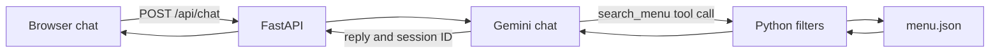

# CECS 458 Group Project Phase 2: Menu Chatbot

Simple website chatbot. The backend uses the Gemini API (free tier) and gives the model a
tool, `search_menu`, that filters `menu.json` by category, price, calories, dietary flags,
spice level, and keyword.

**Prototype status:** This project uses static demonstration data. It has not been connected to a restaurant's live menu, ordering, inventory, or allergen systems.

## What it does

- Accepts natural-language food and drink requests in a browser chat.
- Searches a 15-item sample menu by category, maximum price, maximum calories, dietary flags, maximum spice level, and keyword.
- Carries a Gemini chat session across requests while the server process is running.
- Keeps the Gemini API key on the server in an environment variable; it is not sent to the browser.

## Architecture



The browser sends a message and, after the first response, the session ID returned by the server. FastAPI creates one Gemini chat per session ID in an in-memory dictionary. The model is configured with a restaurant-assistant system instruction and the `search_menu` Python function as a tool. Gemini may call the function with structured filter arguments. The function reads `menu.json`, applies all supplied constraints together, and returns matching menu records. Gemini generates the user-facing response from the tool result.

## Requirements

- Python 3.10 or newer
- A Gemini API key from [Google AI Studio](https://aistudio.google.com/apikey)
- Either [`uv`](https://docs.astral.sh/uv/) or `pip`

## Setup and run

From the project directory:

1. Create a local `.env` file from the example and set your key:

   ```bash
   cp .env.example .env
   ```

   Edit `.env` and replace `your_key_here` with your Gemini API key. The optional `GEMINI_MODEL` setting defaults to `gemini-3.5-flash-lite`.

2. Install dependencies and start the server using one of these options.

   With `uv`:

   ```bash
   uv sync
   uv run uvicorn app:app --reload
   ```

   With `pip`:

   ```bash
   python -m venv .venv
   source .venv/bin/activate       # Windows PowerShell: .venv\Scripts\Activate.ps1
   pip install fastapi uvicorn google-genai python-dotenv
   uvicorn app:app --reload
   ```

3. Open [http://127.0.0.1:8000](http://127.0.0.1:8000) in a browser. Use a prompt chip or enter a request such as “vegan under $12.”

Stop the local server with `Ctrl+C`. The development server's `--reload` option is intended for local development.

## Configuration

| Variable         | Required | Default            | Purpose                                              |
| ---------------- | -------: | ------------------ | ---------------------------------------------------- |
| `GEMINI_API_KEY` |      Yes | None               | Authenticates the server's Gemini API client.        |
| `GEMINI_MODEL`   |       No | `gemini-3.5-flash-lite` | Selects the Gemini model used for new chat sessions. |

Keep credentials in `.env` or another secret manager. `.env` is listed in `.gitignore`; do not commit API keys, passwords, or private data. If the key is missing or invalid, Gemini setup or requests can fail.

## Reproduce a deterministic menu search

The Python filter can be exercised without calling Gemini. From the project directory, run:

```bash
python -c 'from search import search_menu; print("\n".join("{}: ${:.2f}".format(item["name"], item["price"]) for item in search_menu(vegan=True, max_price=12)))'
```

For the supplied sample data, the expected matches are:

```text
Black Bean Burger: $10.50
Chana Masala: $11.50
Garden Salad: $8.00
Garlic Fries: $5.00
Mango Sorbet: $5.00
Fresh Lemonade: $3.50
```

This example verifies only the deterministic menu filter. It does not verify Gemini's interpretation of the phrase, tool-call behavior, or final wording.

## HTTP API

### `GET /`

Returns the chat interface in `static/index.html`.

### `POST /api/chat`

Request JSON:

```json
{
  "message": "vegan under $12",
  "session_id": null
}
```

`message` is required. `session_id` is optional; omit it or pass `null` to start a session. The response includes the assistant reply and the session ID to send with the next request:

```json
{
  "reply": "...",
  "session_id": "..."
}
```

Example request using `curl` after starting the server:

```bash
curl -X POST http://127.0.0.1:8000/api/chat \
  -H 'Content-Type: application/json' \
  -d '{"message":"vegan under $12"}'
```

The response text depends on Gemini and may vary. A Gemini exception is returned as HTTP `502` with a `detail` message.

## Menu data and filter behavior

`menu.json` contains a JSON array of menu records. The current fields are:

| Field                                | Meaning                                          |
| ------------------------------------ | ------------------------------------------------ |
| `id`                                 | Sample record identifier                         |
| `name`                               | Menu item name                                   |
| `category`                           | `entree`, `salad`, `side`, `dessert`, or `drink` |
| `price`                              | Sample price in dollars                          |
| `calories`                           | Sample calorie value                             |
| `vegetarian`, `vegan`, `gluten_free` | Boolean labels in the demonstration data         |
| `spice_level`                        | Integer from 0 (none) through 3 (hot)            |
| `description`                        | Short sample description                         |

Every supplied filter is combined with AND logic. `category` is compared case-insensitively. `keyword` is matched as a case-insensitive substring of the item name or description. Boolean filters are positive-only: `vegan=True` returns vegan items; `vegan=False` does not request non-vegan items and behaves like no vegan constraint.

## Main files

| File                | Purpose                                                                                  |
| ------------------- | ---------------------------------------------------------------------------------------- |
| `app.py`            | FastAPI application, Gemini configuration, session handling, and HTTP routes.            |
| `search.py`         | Loads `menu.json` and implements the deterministic `search_menu` tool.                   |
| `menu.json`         | Static sample menu data used by the search function.                                     |
| `static/index.html` | Browser chat interface and client-side session ID handling.                              |
| `pyproject.toml`    | Python version and package dependency declarations.                                      |
| `.env.example`      | Example environment-variable configuration; put the real key in the ignored `.env` file. |

## Limitations and responsible use

- The menu is a small, static sample. Prices, availability, ingredients, hours, substitutions, and allergens are not synchronized with a business.
- Dietary flags in the sample file are not verified allergen or cross-contamination information. Do not rely on this prototype for allergy-safety decisions.
- The system prompt asks Gemini to search the menu and recommend only returned items, but prompt instructions cannot guarantee that every generated response is accurate. Validate outputs before any real customer use.
- Guest messages are sent to the configured Gemini API. Do not enter sensitive personal information; review the provider's current data-handling terms before deploying the prototype.
- Sessions are stored in server memory and are lost when the process restarts. This prototype has no persistent storage, authentication, rate limiting, or production deployment configuration.
- Tool-call interpretation, response accuracy, performance, and the planned 30-query evaluation have not been measured by this repository documentation.

## Team implementation

The team's technical contribution is the working web-to-model workflow, the Gemini tool integration, the Python menu-search function, a structured sample dataset, and the browser chat interface. Before presenting results, run the application with a configured key and record actual input-to-output examples. Report benchmark results only after executing and documenting the evaluation.
